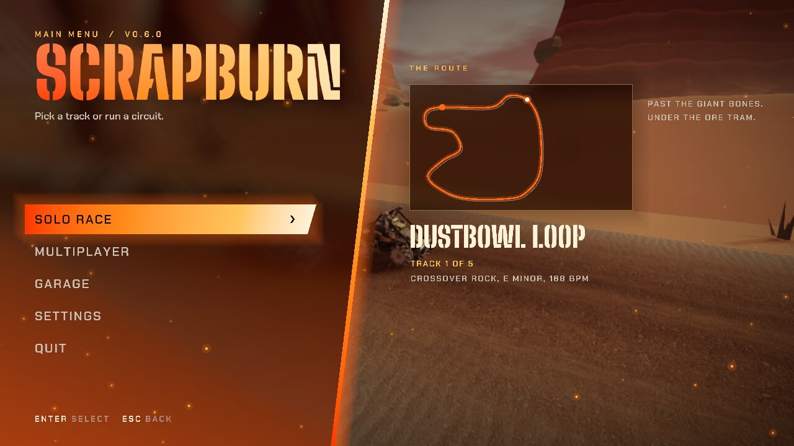
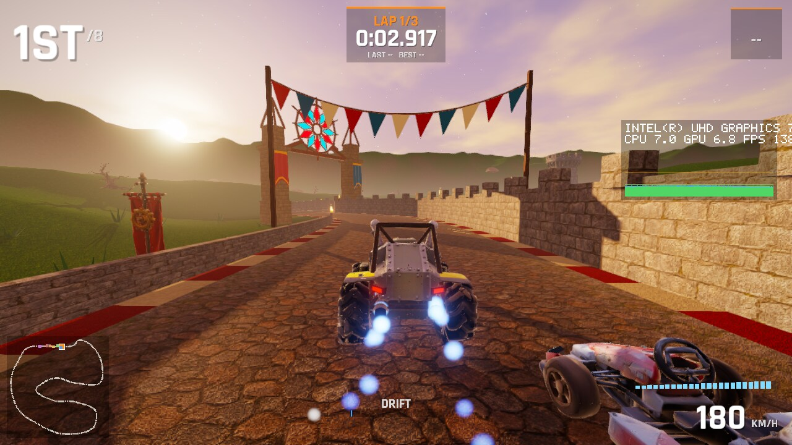

# Rivet + Scrapburn

**Scrapburn** is a combat kart racer: Mario Kart meets Mad Max meets Quake. It's built on
**Rivet**, an original Rust engine inspired by the designs of Quake 3, Doom, Source and
Trackmania. Rivet contains no id Software code.



## Play

```sh
just setup   # installs the pinned toolchain via mise
just run     # title screen
```

Choose **Solo Race** to set up a Grand Prix, Time Trial, or Elimination race. Set **Event** to **Single Track** and open **Track** to preview a route and equip it, or set it to **Circuit** to race every track in order. Circuits award 10, 8, 6, 5, 4, 3, 2 and 1 points per race, and the most points after the final round wins. Time Trial is always a single track.

- **Multiplayer** opens private invites, direct hosting and joining, and your racer name.
- **Garage** previews three chassis and eight finishes on your kart. Click a paint swatch or cycle finishes, then choose **Done** to save.
- **Controls** shows keyboard and gamepad bindings and is also available in the pause menu.
- **Settings** adjusts graphics, lap count, and rivals. Turn **Scenery** on to see the trackside landmarks.

### The circuits

| Driver’s view | Circuit |
|---|---|
|  | **Dustbowl Loop.** Race across an open canyon floor past a sandstone arch and a rusted refinery. Eight-meter sand shoulders give you room to run wide and still cross a checkpoint, but the loose surface costs speed. |
|  | **Castle Grindstone.** Race beneath tournament pennants past the windmill and through a jeweled sun-wheel gate. Look over the low parapet for the slate-roofed great hall midway around the lap, then follow the torchlit ramparts to the drawbridge jump. |
|  | **Skyway Zero.** Launch alongside a cargo airship and follow the banked neon deck above the city. A solar relay marks the far S-bends, and four boost strips reward a clean line. |

### Weapons

Drive through an item box to get one of these. The odds are weighted by your position:

- **Nailer**: a burst of nails that spins out whoever it hits.
- **Harpoon**: hooks the kart ahead and slingshots you past.
- **Plasma Orb**: a slow plasma orb that hunts the leader and zaps everyone it passes.

### Controls

| | Keyboard | Gamepad |
|---|---|---|
| Drive / brake | W / S | Right / left trigger |
| Steer | A / D | Left stick |
| Hop and drift | Space or Shift | Bumper |
| Fire item | E, Ctrl or J | West button (X / Square) |
| Respawn | R | East button (B / Circle) |
| Pause | Esc | Start |
| FPS display | F3 | Select |

**Drifting:** hold hop while turning to drift. Steer into the turn to tighten the arc and
charge faster, or steer away to widen it. Release to boost. Blue, orange, then purple sparks
mark the three boost tiers. Orange pads boost you too, and sand slows you down.

## Online


One player hosts and the others join. The host's machine runs the race, the bots and the
weapons; each player drives their own kart locally, so steering feels immediate at any ping.

- **Host:** Multiplayer, then Host Game. Share your IP address or Tailscale name. The game uses
  UDP port 27960.
- **Join:** Multiplayer, then type the address (`100.64.0.2`, `my-desktop`, `host:port`), or open
  **Tailscale** and pick one of your online peers.
- In the lobby the host can choose **Single Track** or **Circuit**. Everyone advances to the next
  circuit round when the host picks **Next Race**.
- On the command line: `just run --host` or `just run --join 100.64.0.2`. Add
  `--name RUSTY` to override your saved name. First-time drivers receive a name like `RACER 4F`.

Choose **Multiplayer → Change Racer Name** to save the name friends see. In a race, a pointer above each nearby human opponent shows their name and seat number. Match it to the live human standings to see their overall race position.

For direct Internet play, the host needs a reachable UDP port. Friends on the same
Tailscale network can join using their tailnet addresses. Up to eight racers can play, and bots fill the empty seats.
Online races can't be paused.

Online play is meant for friends. Clients are trusted to report their own kart honestly.

### Private Tailcat invites

Extract the full distribution and launch **scrapburn**. Private multiplayer is built
into **Multiplayer**. Players do not need a Tailscale account, Go, Tailcat, or just installed.

- **Host Private Race** creates an invite and copies it to your clipboard. Paste it to
  your friends in any chat app; **Copy Invite** in the lobby copies it again. Start the
  race when everyone appears in the lobby.
- Guests copy the invite, then choose **Paste Invite & Join**.
- The invite contains a private connection key. Share it with your guests only.
  Leaving the host session expires the invite.

Keep the bundled `scrapburn-tailcat` helper next to the game executable. Tailcat uses an outbound
relay to establish the tunnel and attempts a direct path between players.
[Tailcat networking documentation](https://github.com/tailscale/tailcat#how-it-works)

For source builds, `just tailcat-host` and `just tailcat-join` still support text invites
in the terminal. Packaging builds the helper with the pinned toolchain in
`tools/tailcat/mise.toml` (`mise -C tools/tailcat install`).

## Options

```sh
just run --track castle                      # open with Castle Grindstone selected
just run --preset low                        # for older integrated GPUs
just bench                                   # 30 s automated benchmark
```

- `--adapter auto|integrated|discrete|<name>` (or `RIVET_ADAPTER`): `auto` uses the GPU
  driving your display.
- `--size 1600x900`, `--present vsync|immediate`.
- `--preset low|medium|high`: Low renders the 3D scene at 75% scale.
- `--track dustbowl|castle|skyway` selects the circuit. For an automated race,
  `just bench --track castle --mode elimination` selects both the circuit and the race mode.

From a graphical session, use `--offscreen` to benchmark a GPU without a monitor attached.

```sh
just bench --adapter integrated --offscreen --screenshot shot.png
```

With eight karts on an Intel UHD 730 at 1600×900 and Medium settings, Dustbowl averaged
131 fps, Castle 139 fps, and Skyway 175 fps. [Benchmark results and reproduction steps](docs/perf/2026-11-27-circuit-scenery.md)

## Building

Linux builds need libudev and ALSA headers (`libudev-dev` and `libasound2-dev`, or
`systemd-devel` and `alsa-lib-devel`, or Homebrew `systemd` and `alsa-lib`). The workspace
also type-checks for Windows (`cargo check --target x86_64-pc-windows-gnu`).

On Linux, `just package` compiles the game in a rootless podman container on AlmaLinux 8,
so the release needs only glibc 2.28 (Debian 10, Ubuntu 20.04, RHEL 8, any current Fedora)
rather than the build host's glibc. The bundled helper is a static Go binary.

`just package-windows` cross-compiles a Windows x86_64 `.zip` from Linux the same way,
with MinGW-w64 in a podman container. On Windows itself, `just package` builds natively.

```sh
just package         # target/dist/scrapburn-<version>-linux-x86_64.zip
just package-windows # target/dist/scrapburn-<version>-windows-x86_64.zip
just ci              # fmt check, clippy, tests, cargo-audit and cargo-deny, release build
```

## Releases and updates

Bump `version` in the workspace `Cargo.toml`, merge it to `main`, then push a matching
tag (`git tag v0.2.0 && git push origin v0.2.0`). The release workflow builds the Linux
and Windows zips, writes `SHA256SUMS`, attests their provenance and publishes a GitHub
release.

A packaged install (one with a `scrapburn.release` file beside the game) checks for a
newer release when it starts, in the background and with a short timeout, so it plays
the same offline. When one exists, the title screen offers **UPDATE TO vX.Y.Z**. The
game then downloads the zip for its platform, checks it against `SHA256SUMS`, swaps it
into the install folder and restarts. Saves live in the user data folder and are not
touched. Set `SCRAPBURN_NO_UPDATE=1` to turn the updater off. Builds run from a source
checkout never update.

## The engine

Rivet is a set of small crates, each usable on its own:

| Crate | What it does |
|---|---|
| `rivet-core` | Fixed-timestep clock and frame statistics |
| `rivet-platform` | Window, keyboard, gamepads, GPU adapter selection |
| `rivet-render` | wgpu renderer: HDR, shadows, materials, sky, bloom, particles, TrueType HUD text |
| `rivet-physics` | Triangle-mesh collision and arcade kart physics (suspension, drift tiers, surfaces) |
| `rivet-ai` | Racing-line bots that drift, dodge and recover |
| `rivet-audio` | A procedural sound mixer (engines, skids, weapons) |
| `rivet-assets` | GLB and texture loading |
| `rivet-net` | UDP host/client links with a handshake, session tokens and timeouts, plus a byte codec |

The karts and 19 scenery props were modeled with Tripo and prepared in Blender. Five circuit
landmarks use original procedural meshes with embedded texture atlases. The terrain and road
surfaces use original generated textures. The HUD uses Rajdhani under the SIL Open Font License.
[Model credits](assets/models/PROVENANCE.md) · [Texture credits](assets/textures/PROVENANCE.md) · [Font credits](assets/fonts/PROVENANCE.md)

## License

Licensed under either of [Apache License, Version 2.0](LICENSE-APACHE) or
[MIT license](LICENSE-MIT) at your option.
