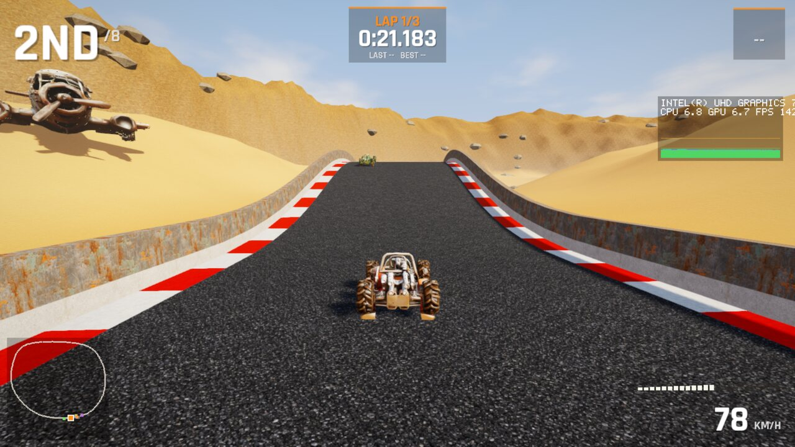
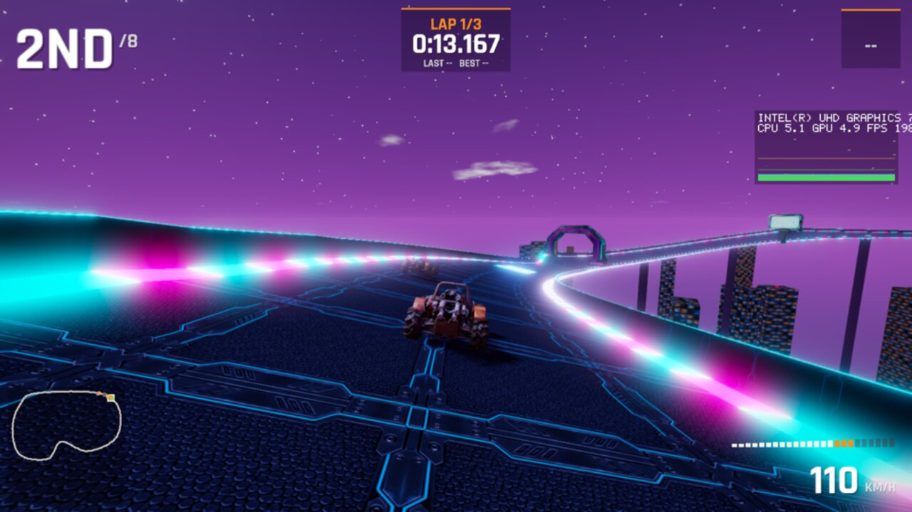
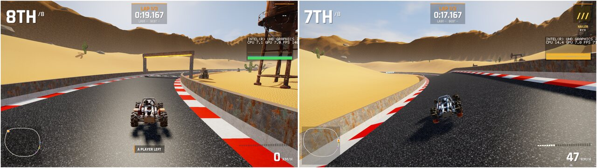

# Rivet + Nailrunners

**Nailrunners** is a combat kart racer: Mario Kart meets Mad Max meets Quake. It's built on
**Rivet**, an original Rust engine inspired by the designs of Quake 3, Doom, Source and
Trackmania. Rivet contains no id Software code.


## Play

```sh
just setup   # installs the pinned toolchain via mise
just run     # title screen
```

From the title screen:

- **Race**: three laps against seven rivals, with weapons.
- **Time Trial**: solo laps against your best-lap ghost.
- **Elimination**: last place is knocked out every lap until one survivor wins.
- **Online**: host a game, or join a friend by address or Tailscale name.
- **Track**: pick a circuit (left/right).

### The circuits

| | |
|---|---|
|  | **Dustbowl Loop.** A sun-blasted canyon circuit. A horned skull rock looms over a refinery, a downed cargo plane, wrecks, and a jump over the dunes. |
|  | **Castle Grindstone.** Torchlit ramparts at dusk. A tight, technical fortress circuit with towers, a gatehouse, stone guardians, and a drawbridge jump. |
|  | **Skyway Zero.** A neon ribbon 40 m above a sleeping city at night. Fast, banked by curvature, with four boost strips. Don't look down. |

### Weapons

Drive through an item box to get one of these. The odds are weighted by your position:

- **Nailer**: a burst of nails that spins out whoever it hits.
- **Harpoon**: hooks the kart ahead and slingshots you past.
- **Doom Orb**: a slow plasma orb that hunts the leader and zaps everyone it passes.

### Controls

| | Keyboard | Gamepad |
|---|---|---|
| Drive / brake | W / S | Right / left trigger |
| Steer | A / D | Left stick |
| Hop and drift | Space or Shift | Bumper |
| Fire item | E, Ctrl or J | West button (X / Square) |
| Respawn | R | East button (B / Circle) |
| Pause | Esc | Start |
| FPS display | F3 | Select |

**Drifting:** hold hop while turning to drift. Steer into the turn to tighten the arc and
charge faster, or steer away to widen it. Release to boost. Blue, orange, then purple sparks
mark the three boost tiers. Orange pads boost you too, and sand slows you down.

## Online



One player hosts and the others join. The host's machine runs the race, the bots and the
weapons; each player drives their own kart locally, so steering feels immediate at any ping.

- **Host:** Online, then Host Game. Share your IP address or Tailscale name. The game uses
  UDP port 27960.
- **Join:** Online, then type the address (`100.64.0.2`, `my-desktop`, `host:port`), or pick
  one of your online Tailscale peers from the list.
- On the command line: `just run --host` or `just run --join 100.64.0.2`. Add
  `--name RUSTY` to set your name; by default it's your user name.

Tailscale is the easy path: it works across networks with nothing to forward. Without it, the
host must forward UDP 27960. Up to eight racers can play, and bots fill the empty seats.
Online races can't be paused.

Online play is meant for friends. Clients are trusted to report their own kart honestly.

## Options

```sh
just run --track castle --mode elimination   # straight into a race
just run --preset low                        # for older integrated GPUs
just bench                                   # 30 s automated benchmark
```

- `--adapter auto|integrated|discrete|<name>` (or `RIVET_ADAPTER`): `auto` uses the GPU
  driving your display.
- `--size 1600x900`, `--present vsync|immediate`.
- `--preset low|medium|high`: Low renders the 3D scene at 75% scale.
- `--track dustbowl|castle|skyway`, `--mode race|timetrial|elimination`.

A GPU with no monitor attached can still be benchmarked offscreen:

```sh
just bench --adapter integrated --offscreen --screenshot shot.png
```

Measured on an Intel UHD 730 (desktop iGPU), Medium preset, 1600×900, 8 karts:
about 155 fps on Dustbowl and Castle and about 190 fps on Skyway (5–7 ms GPU per frame).

## Building

Linux builds need libudev and ALSA headers (`libudev-dev` and `libasound2-dev`, or
`systemd-devel` and `alsa-lib-devel`, or Homebrew `systemd` and `alsa-lib`). The workspace
also type-checks for Windows (`cargo check --target x86_64-pc-windows-gnu`).

```sh
just ci      # fmt check, clippy, tests, cargo-audit and cargo-deny, release build
```

## The engine

Rivet is a set of small crates, each usable on its own:

| Crate | What it does |
|---|---|
| `rivet-core` | Fixed-timestep clock and frame statistics |
| `rivet-platform` | Window, keyboard, gamepads, GPU adapter selection |
| `rivet-render` | wgpu renderer: HDR, shadows, materials, sky, bloom, particles, TrueType HUD text |
| `rivet-physics` | Triangle-mesh collision and arcade kart physics (suspension, drift tiers, surfaces) |
| `rivet-ai` | Racing-line bots that drift, dodge and recover |
| `rivet-audio` | A procedural sound mixer (engines, skids, weapons) |
| `rivet-assets` | GLB and texture loading |
| `rivet-net` | UDP host/client links with a handshake, session tokens and timeouts, plus a byte codec |

Art is original: textures were generated with Codex, models with Tripo and cleaned up in
Blender (see the `PROVENANCE.md` files under `assets/`). The HUD font is Rajdhani (SIL OFL).

## License

Licensed under either of [Apache License, Version 2.0](LICENSE-APACHE) or
[MIT license](LICENSE-MIT) at your option.
